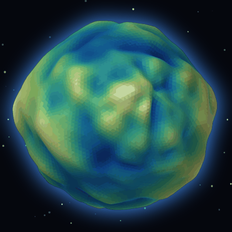

# memory-sphere

> **Turn a bag of high-dimensional vectors into a terrain globe you can spin.**
>
> 10,441 memories, 1,024 dims each → PCA → 1,024 equal-area sphere anchors
> → density / PageRank / entity / recency / type aggregated into a height field
> → displaced icosphere with contour lines, and a 25-frame time slider.



*(36 frames, 3.6 s per turn, rendered offline from the same pipeline — no screen recorder, no private data)*

**[▶ Live demo — drag the globe](https://masterltx.github.io/memory-sphere/)** (3,000 synthetic memories, no private data)

## What it actually does

Most vector visualisations give you a dot cloud: 10k points, no structure you can point at.
This one **aggregates first, then draws**:

| stage | what happens |
|---|---|
| 1. preprocess | centre on the mean, L2-normalise |
| 2. reduce | covariance eigen-decomposition, 1024 → 50 → first 3 (≈0.3 s) |
| 3. sphere | normalise the 3D coordinates onto S² |
| 4. bin | 32×32 **equal-area** lat/lon grid — 1,024 anchors, each π/256 of the sphere |
| 5. aggregate | per anchor: count, mean PageRank, mean entity count, recency, type weight |
| 6. height | weighted **rank**-normalised sum → `h ∈ [0,1]` |
| 7. smooth | seam-aware separable Gaussian + band-pass for the hills |
| 8. displace | `R = 1 + α(h − 0.5)`, α = 0.28 |
| 9. render | icosphere (no polar singularity), normals from the **displaced** geometry |

Why PCA instead of UMAP: measured on real data, the top-3 components hold only 10% of the
variance **but the residual is isotropic** — singular values 61.3 / 58.7 / 56.9 (ratio 0.928),
sphere centroid offset 0.058, and 1,020 of 1,024 bins get populated. Uniformly spread
information carries no structure, so UMAP/k-means would only add distortion. See
[`docs/formulas.md`](docs/formulas.md).

## Quick start

```bash
git clone https://github.com/MasterLTX/memory-sphere
cd memory-sphere
python -m venv .venv && . .venv/bin/activate    # Windows: .venv\Scripts\activate
pip install -r requirements.txt

python -m sphere demo        # synthesises 3,000 fake memories, builds the globe
open out/memory_sphere_deck.html
```

No database, no API key, no network (except the first run, which fetches `three.js` + `KaTeX`
into `vendor/`).

## Use your own memory

Drop four files into `data/input/` — only the first is required:

| file | format |
|---|---|
| `embeddings.tsv` | `id <tab> type <tab> date <tab> [v1,v2,…,vn]` |
| `links.tsv` | `src <tab> dst <tab> weight <tab> kind` |
| `ent_count.tsv` | `unit_id <tab> count` |
| `models.tsv` | `name <tab> [v1,v2,…,vn]` |

With only `embeddings.tsv` the pipeline degrades to a pure-density globe instead of failing.
If you use Hindsight as your memory store, `adapters/hindsight_export.sql`
dumps those files (read-only, no writes).

## Layout

```
sphere/pipeline/   the original flat scripts (being folded into a package)
adapters/          exporters that produce the four input files
docs/              formulas, architecture, pitfalls
examples/          committed demo output
scripts/           regression checks (hero spin direction, pixel-based)
```

## Pitfalls already paid for

1. **Lat/lon mesh rendering** — poles degenerate into a radial starburst. Use icosphere for
   drawing, keep the lat/lon grid for *statistics only*.
2. **`IcosahedronGeometry(1, 5)` is not 5-level recursive subdivision** — it is
   `20 × (detail+1)²` faces, i.e. 720. Use `detail=31` for 20,480.
3. **`PolyhedronGeometry` is non-indexed** — `computeVertexNormals()` gives flat shading until
   you weld vertices by position.
4. **Normals must come from the displaced geometry**, not the sphere direction, or the front
   face shows no hills at all.
5. **CSS class collisions** — `querySelectorAll('.btn')` silently bound a second handler to a
   toggle button, writing `undefined` into the field selector and killing the render before the
   colour loop ran. Scope selectors with a data attribute.
6. **A spin can be wrong and still look like motion.** `Rx(t)` sends the spin axis `ŷ` to
   `(0, cos t, sin t)`; at `t = 72°` that is 95% along `+z` — the view direction — so the globe
   rotates *in the image plane* like a plate instead of turning like a planet. Four still frames
   side by side look convincing either way. Decide from pixels, not eyes:
   `python scripts/check_hero_spin.py` fits a rotation model and a translation model to
   consecutive frames and fails if the rotation one wins.

## License

MIT. Bundled at build time: three.js (MIT), KaTeX (MIT) — see `THIRD_PARTY_NOTICES.md`.