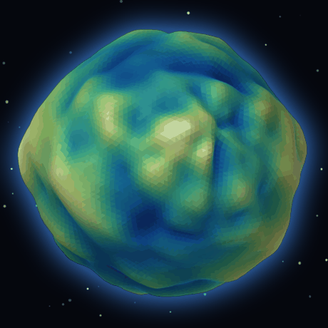

# memory-sphere

**简体中文** · [English](README.md)

> **把一堆高维向量，变成一个能用手转的地形星球。**
>
> 10,441 条记忆，每条 1,024 维 → PCA → 1,024 个等面积球面锚点
> → 密度 / PageRank / 实体数 / 新近度 / 类型 聚合成一个高度场
> → 位移二十面体球 + 等高线，外加一条 25 帧的时间滑块。



*（36 帧，3.6 秒转一圈，由同一条管线离线渲染——没有录屏，也没有私有数据）*

**[▶ 在线演示——可以直接拖着转](https://masterltx.github.io/memory-sphere/)**（3,000 条合成记忆，不含私有数据）

## 它到底做了什么

大多数向量可视化给你的是一团点云：10k 个点，指不出任何结构。
这个项目**先聚合，再作图**：

| 阶段 | 做了什么 |
|---|---|
| 1. 预处理 | 去均值、L2 归一化 |
| 2. 降维 | 协方差特征分解，1024 → 50 → 前 3 维（约 0.3 秒） |
| 3. 球面 | 把 3D 坐标归一化到 S² 上 |
| 4. 分箱 | 32×32 **等面积**经纬网格——1,024 个锚点，每个占球面的 π/256 |
| 5. 聚合 | 每个锚点统计：数量、平均 PageRank、平均实体数、新近度、类型权重 |
| 6. 高度 | 加权 **秩** 归一化求和 → `h ∈ [0,1]` |
| 7. 平滑 | 缝感知的可分离高斯 + 带通滤波，做出山形 |
| 8. 位移 | `R = 1 + α(h − 0.5)`，α = 0.28 |
| 9. 渲染 | 二十面体球（没有极点奇点），法线取自**位移后**的几何体 |

为什么用 PCA 而不是 UMAP：在真实数据上实测，前 3 个主成分只占 10% 的方差，
**但残差是各向同性的**——奇异值 61.3 / 58.7 / 56.9（比值 0.928），球面质心偏移 0.058，
1,024 个箱里有 1,020 个被填满。均匀铺开的信息本身不携带结构，
再用 UMAP/k-means 只会引入畸变。具体算式见
[`sphere/pipeline/build_sphere.py`](sphere/pipeline/build_sphere.py)。

## 快速开始

```bash
git clone https://github.com/MasterLTX/memory-sphere
cd memory-sphere
python -m venv .venv && . .venv/bin/activate    # Windows: .venv\Scripts\activate
pip install -r requirements.txt

python -m sphere demo        # synthesises 3,000 fake memories, builds the globe
open out/memory_sphere_deck.html
```

不需要数据库、不需要 API key、不需要联网（首次运行会拉 `three.js` 和 `KaTeX` 到 `vendor/`）。

## 用你自己的记忆

往 `data/input/` 里丢四个文件——只有第一个是必需的：

| 文件 | 格式 |
|---|---|
| `embeddings.tsv` | `id <tab> type <tab> date <tab> [v1,v2,…,vn]` |
| `links.tsv` | `src <tab> dst <tab> weight <tab> kind` |
| `ent_count.tsv` | `unit_id <tab> count` |
| `models.tsv` | `name <tab> [v1,v2,…,vn]` |

只给 `embeddings.tsv` 时，管线会退化成纯密度星球，而不是直接报错。
如果你的记忆存在 Hindsight 里，`adapters/hindsight_export.sql`
能把上面几个文件导出来（只读，不写入）。

## 目录结构

```
sphere/pipeline/   the original flat scripts (being folded into a package)
adapters/          exporters that produce the four input files
docs/              formulas, architecture, pitfalls
examples/          committed demo output
scripts/           regression checks (hero spin direction, pixel-based)
```

## 踩过的坑

1. **用经纬网格直接渲染**——极点会退化成一圈放射状星芒。画图用二十面体球，
   经纬网格只留给**统计**用。
2. **`IcosahedronGeometry(1, 5)` 不是 5 级递归细分**——它是 `20 × (detail+1)²` 个面，
   也就是 720 个。想要 20,480 个面得写 `detail=31`。
3. **`PolyhedronGeometry` 是非索引几何**——除非按位置把顶点焊起来，
   否则 `computeVertexNormals()` 出来的全是平面着色。
4. **法线必须取自位移后的几何体**，不能直接用球面方向，否则正面一个山包都看不见。
5. **CSS 类名撞车**——`querySelectorAll('.btn')` 悄悄给一个切换按钮绑了第二个处理器，
   把 `undefined` 写进了字段选择器，还没轮到配色循环渲染就死了。用 data 属性把选择器圈起来。
6. **转错了也像在转。** `Rx(t)` 把自转轴 `ŷ` 送到 `(0, cos t, sin t)`；
   取 `t = 72°` 时它 95% 指向 `+z`——也就是视线方向——于是星球是在**画面内**像转盘子一样转，
   而不是像行星那样自转。四张静止帧并排放，两种错法都看着像"在动"。别用眼判断，用像素：
   `python scripts/check_hero_spin.py` 会把相邻帧分别拟合"绕中心旋转"和"水平平移"两个模型，
   谁赢了就报错。

## 许可

MIT。构建期打包了 three.js（MIT）和 KaTeX（MIT）——详见 `THIRD_PARTY_NOTICES.md`。